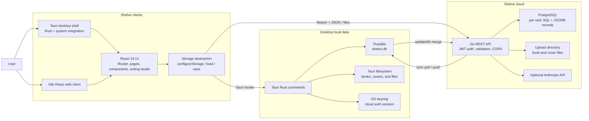

# Project Rules for Copilot

- **Package Manager:** Always use `pnpm` (`pnpm add`, `pnpm remove`). Never use `npm` or `yarn`.
- **No Dev/Build Commands:** Never run `dev`, `build`, `start`, or `preview` scripts in the terminal to test changes. The user already has the dev server running and will test changes manually.
- **Verification:** Only verify code via static TypeScript/lint checks (`pnpm exec tsc --noEmit`) if needed, without starting background processes.

## Project Architecture

### Runtime Data Flow

- `App.tsx` owns application state and routing for library, reader, planner,
  analytics, AI, settings, profile, and writing studio screens.
- `src/lib/storage/index.ts` is the provider boundary. Cloud mode calls the
  Go API; desktop offline mode calls Tauri commands backed by SQLite.
- `src/lib/cloud.ts` uploads file assets and reconciles desktop SQLite records
  with the API through `/api/sync/merge` and `/api/sync/pull`.
- `src/lib/sync/SyncEngine.ts` processes the persistent SQLite sync queue with
  capped exponential backoff and flushes on reconnect or session-token updates.
- The writing status bar exposes queue health and conflict resolution backed by
  the API's conflict listing/resolution routes.
- Rust initializes `shelve.db`, exposes database and auth commands, and stores
  desktop credentials in the OS keyring.
- The Go API owns account authentication, PostgreSQL CRUD, file uploads, sync,
  public writing reads, and optional AI endpoints.

### App Insight

- The strongest part of the implementation is the storage boundary: switching
  between local and cloud data is explicit, and desktop startup can fall back
  to SQLite when the API is unreachable.
- Sync merges records by UUID and `updatedAt`, preserves stale concurrent edits
  as explicit conflicts, and keeps file-upload status separate from record
  status until both stages succeed.
- The Tauri version is the most complete and self-contained implementation in
  the workspace. The separate `app/` directory is a legacy Electron + Next implementation
  branch, and `web/shelve_web/` is a Next.js marketing/docs surface, not the
  main Go-backed desktop application.
- PostgreSQL integration tests require `POSTGRES_TEST_URL`; keep a dedicated
  test database configured to exercise real database and upload behavior.
- Continue testing the React storage adapter and Rust SQLite commands alongside
  the Go API as the sync contract evolves.
